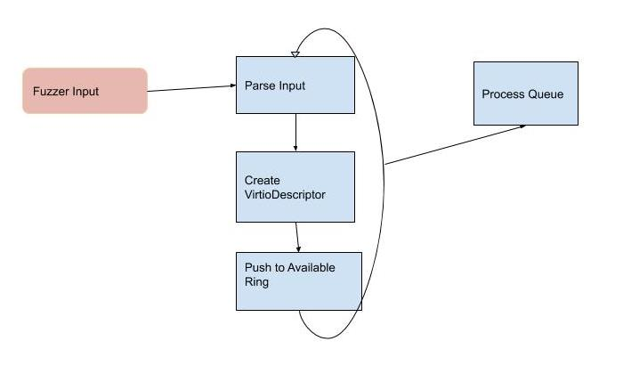
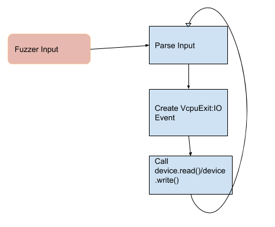
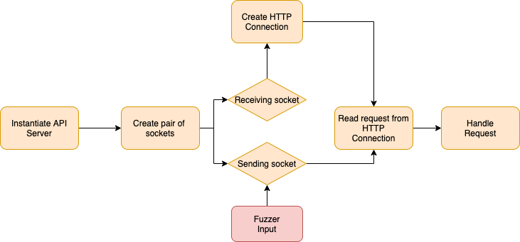

# Fuzzing

Firecracker fuzzes its guest-facing attack surface, and other components such as
the API server and snapshot restore, with the feedback-driven fuzzer
[AFL++](https://github.com/AFLplusplus/AFLplusplus). The fuzz targets live in
[`fuzz/`](../fuzz). AFL++ feeds each target effectively random byte arrays, from
which the target deterministically builds its inputs: for a virtio device, it
uses the bytes to initialize virtio queue descriptors and then asks the device
to process its queues. If an input crashes the target, AFL++ provides the exact
sequence of bytes that reproduces the crash.

Every target is fuzzed nightly, by the pipeline that
[`.buildkite/pipeline_fuzz.py`](../.buildkite/pipeline_fuzz.py) generates, and
Firecracker's PR CI checks that they still compile (see
[Keeping the fuzz targets building](#keeping-the-fuzz-targets-building)).

## Bugs found by fuzzing

Fuzzing has found the following bugs in Firecracker:

1. An off-by-one error in the net device's scatter-gather IO implementation
   ([firecracker#3404](https://github.com/firecracker-microvm/firecracker/pull/3404)).
1. A missing bounds check in `versionize` leading to potential out-of-bounds
   memory reads when deserializing malformed input into `FamStructWrapper`s
   ([CVE-2023-28448](https://cve.mitre.org/cgi-bin/cvename.cgi?name=CVE-2023-28448)).
1. An ignored CR4 validity check result in `KVM_SET_SREGS` on kernel 4.14
   ([[PATCH 0/6] KVM: x86: KVM_SET_SREGS.CR4 bug fixes and cleanup](https://lore.kernel.org/all/20201007014417.29276-1-sean.j.christopherson@intel.com/)).
1. A panic in the virtio-rng device due to not handling descriptors of size 0
   ([firecracker#3714](https://github.com/firecracker-microvm/firecracker/pull/3714)).
1. An unbounded memory allocation in the virtio-net device due to MMDS not
   validating the length of virtio descriptor chains
   ([firecracker#4526](https://github.com/firecracker-microvm/firecracker/pull/4526)).
1. An integer overflow when deciding if we need to scale the TSC on snapshot
   resume
   ([firecracker#4606](https://github.com/firecracker-microvm/firecracker/pull/4606)).
1. Various non-exploitable panics when restoring malformed snapshot files
   ([firecracker#4764](https://github.com/firecracker-microvm/firecracker/pull/4764)).
1. A panic when setting the queue vector for MSI-X interrupts in virtio PCI
   devices, because Firecracker did not check that `queue_select` was in range
   ([firecracker#5335](https://github.com/firecracker-microvm/firecracker/pull/5335)).
1. A panic when accessing the MSI-X vectors of a virtio device after an invalid
   vector choice by the guest
   ([firecracker#5353](https://github.com/firecracker-microvm/firecracker/pull/5353)).

## Fuzz targets

Each target is a binary in `fuzz/src/bin/<target>_fuzz_target.rs`:

| Target        | What it fuzzes                                               |
| ------------- | ------------------------------------------------------------ |
| `api_server`  | HTTP requests to the API server                              |
| `balloon`     | virtio-balloon queues                                        |
| `block`       | virtio-block queues                                          |
| `block_mq`    | multi-queue virtio-block, with one worker thread per queue   |
| `bus_access`  | guest MMIO and PIO accesses to the buses of a booted microVM |
| `legacy`      | the legacy serial and i8042 devices, and the RTC on aarch64  |
| `mem_hotplug` | virtio-mem queues                                            |
| `net`         | virtio-net queues, including MMDS traffic                    |
| `pmem`        | virtio-pmem queues                                           |
| `rng`         | virtio-rng queues                                            |
| `snapshot`    | snapshot restore from malformed snapshot files               |
| `vcpu`        | vCPU state restore                                           |
| `vsock`       | virtio-vsock queues                                          |

`bus_access`, `mem_hotplug`, `pmem`, `snapshot` and `vcpu` open `/dev/kvm`.
Generating the seeds, which `run` and `seeds` do for every target, also needs
`/dev/kvm`, since it creates a VM for the `vcpu` seeds and boots a microVM for
the `snapshot` seeds.

### Virtio devices

The virtio targets skip the device initialization described in section 3.1 of
the
[virtio specification](http://docs.oasis-open.org/virtio/virtio/v1.0/virtio-v1.0.pdf):
they activate the device directly, with feature bits taken from the input. They
then fuzz the operation phase, in which the device processes the buffers that
the untrusted guest driver makes available through its virtio queues. The
targets split the bytes from AFL++ into the fields of virtio descriptors and the
guest memory they reference. Guest accesses to the transport registers are
covered by `bus_access`.



### Legacy devices

Legacy devices interact with the guest driver through well-defined PIO (on
x86_64) or MMIO (on aarch64) register locations. When the guest driver writes to
these locations, the vCPU exits with an IN or OUT exit, and the device reads or
writes the associated data.



### API server

The API server intercepts API requests, forwards them to the VMM and responds to
the user. It is built on an HTTP server that uses Unix domain sockets and
`epoll` to handle multiple connections on the same thread. The target injects
its data as follows:



## Running the fuzzer

All fuzzing runs in the Firecracker development container, through
`tools/devtool fuzz`. The host needs the same
[dependencies](../tests/README.md#dependencies) as the integration tests: KVM,
Docker and `awscli`. The CI guest artifacts come from a public S3 bucket, so no
AWS account is needed.

```bash
tools/devtool fuzz run <target> [-t <cores>] -- -V <duration_in_seconds>
```

`-t` sets how many AFL++ instances fuzz the target in parallel (default 4), and
all arguments after `--` are passed to `cargo afl fuzz`. Without `-V`, AFL++
runs until you stop it with Ctrl+C, after which `run` still processes the
results.

> [!WARNING]
>
> `run` changes host-wide settings: it sets the kernel `core_pattern` to `core`
> and the CPU frequency governor to `performance`, and does not restore them.
> `reproduce`, which `run` also calls at the end, reserves 12 GiB of 2 MiB huge
> pages while it replays crashes. Run them on a dedicated machine rather than
> your workstation.

Before fuzzing, `run` generates the seeds and downloads the CI guest artifacts
the `snapshot` seeds need. A session leaves the following in
`fuzz/out_<target>/`:

- `session_statistics`: AFL++ statistics and the environment of the run.
- `fuzzer*/`: the AFL++ output of each instance, in particular
  - `crashes/`: inputs that caused a crash,
  - `hangs/`: inputs that caused a hang,
  - `queue/`: the corpus generated during the session.
- `coverage.html` and `coverage.tar.gz`: line coverage reports for the target.
- `crashes.tar.gz`: the crashes, with the backtraces `reproduce` collected.
- `hangs.tar.gz`: the hangs.

At the end of the session, `run` replays every crash to collect its backtrace
(see [Debugging crashes](#debugging-crashes)). Since several AFL++ instances
fuzz each target, corpus items may be duplicated across instances.

The other commands are:

- `tools/devtool fuzz check`: type-check all targets.
- `tools/devtool fuzz build <target> [--debug]`: build a target with AFL++
  instrumentation, or in debug mode for crash analysis.
- `tools/devtool fuzz seeds`: generate the seeds under `fuzz/in/`.
- `tools/devtool fuzz fmt [--check]`: format the targets.
- `tools/devtool fuzz help`: list all commands and their options.

## Adding a fuzz target

To add a target for a fictitious audio device:

1. *Write the harness* in `fuzz/src/bin/audio_fuzz_target.rs`. Its main part is
   a `target(input: &[u8])` function, which receives the bytes AFL++ chose for a
   fuzz iteration. Here, it would initialize an audio device, deriving
   configuration such as the sampling rate from the input, and use the remaining
   bytes to drive the device, for example as WAVE audio data to play back. The
   target function must be deterministic, both so that crashes can be reproduced
   by replaying their input and because AFL++ uses the execution paths it
   observes to decide how to mutate inputs. The existing targets show the
   patterns in use. A skeleton harness looks as follows:

   ```rs
   #[cfg(feature = "afl_fuzz")]
   #[macro_use]
   extern crate afl;

   use fuzzer::*;
   // Generate main functions for supported features
   #[cfg(feature = "afl_fuzz")]
   afl_main!(fuzzing::target); // main function used by afl.rs

   #[cfg(feature = "stdin_fuzz")]
   stdin_main!(fuzzing::target); // main function used when replaying corpus items to collect backtraces/coverage

   mod fuzzing {
       pub fn target(input: &[u8]) {
           // Your fuzzing logic goes here
       }
   }
   ```

1. *Provide seeds*: add a unit test to the harness that writes files to
   `in/audio` (relative to `fuzz/`), creating the directory if needed. AFL++
   starts from these inputs, so hand-craft them to reach interesting execution
   paths in the target.

1. *Scope the coverage report*: each session ends with a line coverage report
   limited to the modules relevant to the target. Add the target's sources to
   `relevant_files_for_target` in `fuzz/tools/fuzz`.

The nightly fuzzing pipeline picks up new targets automatically.

### The panic allowlist

Some panics in Firecracker are deliberate: they abort the process when it
detects specific malicious guest behavior. Since these do not indicate a bug,
crashes caused by them should not count as findings. The `ALLOW_LIST` constant
at the top of `fuzz/src/panic.rs` lists such panics. Each entry is a tuple of
the panic message and the
[qualified path](https://doc.rust-lang.org/reference/paths.html#qualified-paths)
of the function containing the `panic!`, including the crate. A message starting
with `?` only has to match the beginning of the panic message, for messages that
contain runtime values. For example:

```rs
("?Some panic message with runtime data", "vmm::devices::virtio::queue::Queue::some_fn"),
```

> [!NOTE]
>
> The allowlist is currently empty, and only builds with the `stdin_fuzz`
> feature (`tools/devtool fuzz build <target> --debug`) check it. `run` and
> `reproduce` replay crashes with the AFL++ build, which aborts on every panic,
> so they report allowlisted panics as crashes too.

## Debugging crashes

AFL++ stores the inputs that caused a crash in
`fuzz/out_<target>/fuzzer*/crashes/`. To replay all of them and collect their
backtraces, run:

```bash
tools/devtool fuzz reproduce <target>
```

To replay a single input, pass its path relative to `fuzz/`:

```bash
tools/devtool fuzz reproduce <target> <input_file>
```

`reproduce` uses the AFL++ build, which does not exit after one input. An input
that does not crash is therefore stopped by `reproduce`'s 5 second timeout and
reported as "Input caused panic", with a `timeout: sending signal TERM` line
instead of a backtrace: that means the input did not crash.

To run an input once through a build that reads it from stdin until EOF, use
`tools/devtool fuzz build <target> --debug`, or run this from `fuzz/` in the
development container (`tools/devtool shell`), after any `tools/devtool fuzz`
command has copied Firecracker's `Cargo.lock` into `fuzz/`:

```bash
cargo run --features stdin_fuzz --no-default-features --bin <target>_fuzz_target < <input_file>
```

## Reporting crashes

A crash that a guest can trigger may be a security issue. If you find a crash
that is not on the panic allowlist, report it privately as described in
[SECURITY.md](../SECURITY.md), rather than in a public issue or pull request.

## Generating coverage reports

`run` generates coverage reports at the end of each session. To generate them
for an existing session, run the coverage scripts from `fuzz/` in the
development container (`tools/devtool shell`). First collect the raw coverage
data (`.profraw` files) by replaying the session's corpus:

```bash
./tools/coverage_backend <target>
```

Then compile the data into a report:

```bash
./tools/coverage_frontend --target <target> --profraw out_<target>/raw_coverage/ --report llvm_html coverage.html
```

Pass `--help` to either script for all options.

## Keeping the fuzz targets building

The fuzz targets use Firecracker's internal APIs, so changing a device or
configuration type can break them without touching `fuzz/`. The `fuzzer-compat`
step of the PR CI type-checks the targets and checks their formatting whenever
Rust sources, manifests, the lock file or `fuzz/` change. If it fails, update
the affected targets in the same pull request. To run the same checks locally:

```bash
tools/devtool fuzz check
tools/devtool fuzz fmt --check
```

## The `fuzzing` feature

> [!WARNING]
>
> The fuzzing feature is not for production use. Binaries built with this
> feature must never be deployed to production.

Firecracker includes compile-time helpers for fuzz testing its internals via the
`fuzzing` feature flag, which the fuzz targets enable.

### What it changes

Building with `--features fuzzing` alters several subsystems to make Firecracker
more amenable to fuzz testing:

- TCP Initial Sequence Numbers use a deterministic hardcoded value instead of
  the usual random ones, so network behavior is reproducible across runs.
- The balloon device processes the stats queue inline rather than relying on the
  timer-driven path, which is not available during fuzzing.

### Building

To build Firecracker with the fuzzing helpers enabled:

```bash
cargo build --features "fuzzing"
```
